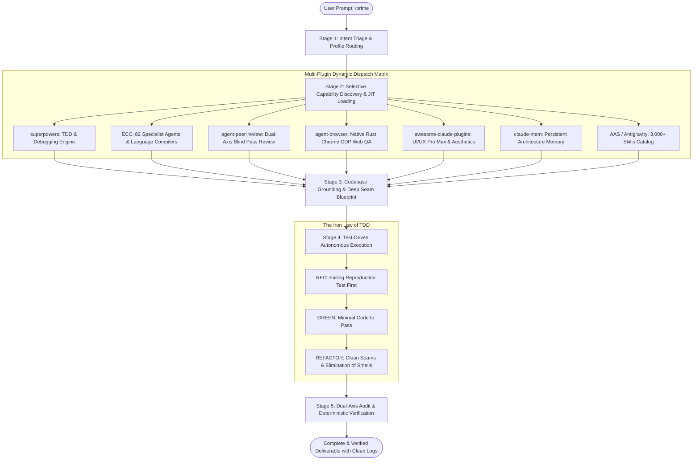

<div align="center">

# ⚡ PRIME

### Universal Autonomous AI Engineering Platform & Multi-Agent Harness

[](scripts/prime-validate.ps1)
[](catalogs/prime-agent-directory.json)
[](catalogs/skills-index-agentic.json)
[](LICENSE)
[](CONTRIBUTING.md)

<br/>

```text
  ██████╗ ██████╗ ██╗███╗   ███╗███████╗
  ██╔══██╗██╔══██╗██║████╗ ████║██╔════╝
  ██████╔╝██████╔╝██║██╔████╔██║█████╗  
  ██╔═══╝ ██╔══██╗██║██║╚██╔╝██║██╔══╝  
  ██║     ██║  ██║██║██║ ╚═╝ ██║███████╗
  ╚═╝     ╚═╝  ╚═╝╚═╝╚═╝     ╚═╝╚══════╝
    AUTONOMOUS AI ENGINEERING PLATFORM
```

**One Slash Command (`/prime`) to Rule Them All.**  
*Transform any AI coding assistant into an elite, disciplined software engineering team with 82 specialist agents, multi-agent debates, and the Iron Law of TDD.*

---

[Quick Start](#-quick-start--installation) •
[Architecture](#-system-architecture) •
[Specialist Agents](#-specialist-agents-catalog) •
[Command Manual](COMMANDS.md) •
[Multi-Agent Deliberation](#-multi-agent-deliberation--group-debates) •
[Cross-Platform Guide](docs/CROSS-PLATFORM.md)

</div>

---

## 🌟 What is Prime?

**Prime** is a unified, cross-platform autonomous AI engineering harness. Rather than treating AI as a simple autocomplete tool, Prime coordinates **82 domain-specialist agents**, enforces strict **Test-Driven Development (TDD)** discipline, facilitates **multi-agent adversarial debates**, and dynamically dispatches tasks to the world's leading engineering plugins.

It works natively across **every major AI coding platform in existence**:
- 🌌 **Google Antigravity IDE**
- 🤖 **Claude Code (Anthropic)**
- 🧠 **OpenAI Codex / ChatGPT**
- ⚡ **Cursor IDE**
- 🌊 **Windsurf (Codeium Cascade)**
- 🦘 **Roo Code (Roo Cline) & Cline**
- ⏩ **Continue.dev**
- 🐙 **GitHub Copilot**
- 💻 **Standalone Terminal CLI (Windows, macOS, Linux)**

---

## ⚡ Quick Start & Installation

Prime installs in seconds via automated, deterministic scripts.

### Method 1: Single-Command Automated Installer (Recommended)

#### Windows (PowerShell):
```powershell
irm https://raw.githubusercontent.com/primebro69/prime/main/install.ps1 | iex
```
*(Or inside a cloned repo: `powershell -ExecutionPolicy Bypass -File .\install.ps1`)*

#### macOS / Linux (Bash):
```bash
curl -fsSL https://raw.githubusercontent.com/primebro69/prime/main/install.sh | bash
```
*(Or inside a cloned repo: `./install.sh`)*

---

### Method 2: Tell Your AI Coding Agent to Install Prime

If you are already inside **Cursor**, **Claude Code**, **Windsurf**, or **Antigravity**, simply paste this instruction to your AI assistant:

```text
Please install the Prime Autonomous AI Platform into this workspace from https://github.com/primebro69/prime
Execute the workspace installer:
powershell -ExecutionPolicy Bypass -File .\scripts\prime-install.ps1 -TargetWorkspace "."
```

---

### Method 3: Claude Code CLI Plugin

```bash
claude plugin install primebro69/prime
```

---

### Method 4: NPM / NPX (Instant Run Without Installation)

```bash
# Run once via npx:
npx prime-ai "analyze this project and identify defects"

# Or install globally:
npm install -g prime-ai
prime "build a REST API with cursor pagination"
```

---

## 🏛️ System Architecture

Prime operates through a deterministic 5-stage orchestration protocol:



---

## 🧩 Multi-Plugin Dynamic Dispatch Matrix

Prime does not treat plugins as generic tools. Every engineering task is routed to its **Best-in-Class Lead Plugin**:

| Domain / Task Type | Lead Plugin | Key Superpowers |
| :--- | :--- | :--- |
| **🧪 TDD & Systematic Bug Fixing** | **`superpowers`** | Iron Law of TDD, 4-phase root cause analysis, clean seam placement, verification before completion. |
| **🌐 82 Specialists & Compilers** | **`ECC`** | 82 dedicated agents, language build resolvers (Python, TS, Rust, Go, Java, Flutter, C++, C#), silent failure hunting. |
| **⚖️ Code Review & Security Audit** | **`agent-peer-review`** | Symmetric blind-pass reviews across Standards and Spec axes; per-issue stance debates. |
| **🖥️ Real Browser Automation** | **`agent-browser`** | Native Rust Chrome CDP automation, accessibility tree snapshots (`@eN`), visual screenshots. |
| **🎨 World-Class UI/UX Design** | **`awesome-claude-plugins`** | Curated HSL dark palettes, Outfit/Inter typography, fluid micro-interactions, responsive mobile-first layouts. |
| **🧠 Cross-Session Context** | **`claude-mem`** | Long-term architectural decision graphs, session memory compaction, project continuity. |
| **📚 3,000+ Skills Discovery** | **`AAS + antigravity-skills`** | Instant sub-second search across battle-tested runbooks (Docker, AWS, GraphQL, PyTorch, Three.js). |
| **⚡ High-Density Token Saver** | **`caveman`** | Strips conversational filler, saving context window tokens while preserving technical rigor. |

*See [docs/PLUGIN-DISPATCH.md](docs/PLUGIN-DISPATCH.md) for full architectural documentation.*

---

## 🤖 82 Specialist Agents Catalog

Prime ships with **82 elite specialist agents** categorized across key engineering domains. All agents are lazy-loaded on demand:

<details>
<summary><b>Click to expand the full Specialist Agents Directory (82 Agents)</b></summary>
<br/>

| Domain | Key Specialist Agents |
| :--- | :--- |
| **Architecture & Design** | `architect`, `code-architect`, `seam-architect`, `homelab-architect`, `network-architect`, `a11y-architect` |
| **Multi-Agent Orchestration** | `agent-mediator` *(Debate Mediator)*, `agent-factory` *(Autonomous Agent Builder)*, `agent-evaluator`, `loop-operator`, `chief-of-staff` |
| **Backend & APIs** | `api-architect`, `backend-architect`, `database-reviewer`, `database-migration-specialist`, `crypto-trading-architect` |
| **Testing & Quality Assurance**| `tdd-guide`, `e2e-runner`, `browser-automator`, `pr-test-analyzer`, `agent-evaluator` |
| **Debugging & Error Fixes** | `build-error-resolver`, `silent-failure-hunter`, `refactor-cleaner`, `network-troubleshooter` |
| **Language Reviewers** | `typescript-reviewer`, `python-reviewer`, `rust-reviewer`, `go-reviewer`, `java-reviewer`, `kotlin-reviewer`, `swift-reviewer`, `flutter-reviewer`, `cpp-reviewer`, `csharp-reviewer`, `php-reviewer`, `fastapi-reviewer`, `django-reviewer` |
| **Language Build Resolvers** | `react-build-resolver`, `rust-build-resolver`, `go-build-resolver`, `java-build-resolver`, `kotlin-build-resolver`, `swift-build-resolver`, `dart-build-resolver`, `cpp-build-resolver`, `django-build-resolver`, `pytorch-build-resolver`, `harmonyos-app-resolver` |
| **Security & Governance** | `security-reviewer`, `governance-auditor`, `opensource-sanitizer`, `spec-miner` |
| **UI/UX & Frontend** | `ui-ux-designer`, `frontend-patterns`, `react-reviewer`, `vue-reviewer`, `a11y-architect` |
| **DevOps & Containers** | `container-architect`, `harness-optimizer`, `network-config-reviewer`, `opensource-packager` |
| **AI & Machine Learning** | `mle-reviewer`, `rag-pipeline-reviewer`, `gan-generator`, `gan-evaluator`, `gan-planner` |

*Complete machine-readable directory: [catalogs/prime-agent-directory.json](catalogs/prime-agent-directory.json).*
</details>

---

## 💬 Multi-Agent Deliberation & Group Debates

Complex architectural decisions shouldn't rely on a single agent's confirmation bias. Prime introduces the **Multi-Agent Deliberation Protocol** (`agent-mediator`):

```text
┌─────────────────────────────────────────────────────────────┐
│                 ROUND 1: INDEPENDENT STANCES                │
│ Each specialist agent formulates an independent proposal    │
│ strictly through their domain lens (Blind Pass).            │
└──────────────────────────────┬──────────────────────────────┘
                               │
┌──────────────────────────────▼──────────────────────────────┐
│           ROUND 2: CROSS-EXAMINATION & CHALLENGE            │
│ Agents challenge peers: Security critiques exposed APIs,    │
│ Performance challenges overhead, TDD demands mock seams.    │
└──────────────────────────────┬──────────────────────────────┘
                               │
┌──────────────────────────────▼──────────────────────────────┐
│           ROUND 3: MEDIATED CONSENSUS SYNTHESIS             │
│ agent-mediator synthesizes all valid points into a single   │
│ bulletproof, compromise-free technical consensus.           │
└─────────────────────────────────────────────────────────────┘
```

**Try a live debate:**
```bash
/prime debate "JWT stored in LocalStorage vs HttpOnly Secure Cookies for SPA authentication"
```
*See [docs/AGENT-DELIBERATION.md](docs/AGENT-DELIBERATION.md) for full guide.*

---

## 🏭 Autonomous Agent Factory (Runtime Generation)

Need an agent specialized in a niche tool or custom framework? Prime's **Agent Factory** (`agent-factory`) dynamically synthesizes, validates, and registers new agents on the fly:

```bash
/prime build-agent "Supabase specialist for Row-Level Security and realtime subscriptions"
```

The factory writes `agents/<name>.md`, configures prompt defense baselines, registers the agent in `catalogs/prime-agent-directory.json`, and synchronizes all packages in seconds.

---

## ⚡ Zero-Overhead JIT Lazy Loading

Unlike monolithic plugins that overload RAM and context windows, Prime uses **Just-In-Time (JIT) Lazy Loading**:
- **0 MB Idle RAM / 0% CPU**: Prime does not run heavy background daemons.
- **Lightweight Registry (~30 KB)**: The agent index contains only metadata.
- **Selective Memory Activation**: When you run `/prime`, only the **1 to 3 relevant agents** are loaded. The remaining 79+ agents remain dormant on disk.
- **Instant Context Release**: Agent instructions unbind immediately after turn completion.

*See [docs/LAZY-LOADING.md](docs/LAZY-LOADING.md) for resource benchmarks.*

---

## 🧪 The Iron Law of TDD

Prime strictly enforces disciplined software engineering:

```
NO PRODUCTION CODE WITHOUT A FAILING TEST FIRST
```

1. **RED**: Formulate a minimal, expressive test demonstrating the required feature or reproducing the bug.
2. **Verify RED**: Confirm the test fails for the expected reason (not a syntax typo).
3. **GREEN**: Write only the minimal production code necessary to turn the test green.
4. **Verify GREEN**: Confirm all test suites pass cleanly with zero exit codes.
5. **REFACTOR**: Eliminate duplication and improve seams while keeping tests green.

---

## 📋 Master Command Cheatsheet

For an exhaustive manual of 80+ categorized commands, see **[COMMANDS.md](COMMANDS.md)**.

### Popular Everyday Commands:

```bash
# 1. Full-System Audit & Autonomous Defect Repair
/prime analyze this project, identify its problems, and implement the necessary fixes.

# 2. Test-Driven Feature Implementation
/prime build a RESTful user authentication service with JWT and bcrypt

# 3. Bug Hunting & Root-Cause Resolution
/prime fix the unhandled promise rejection in auth controller

# 4. Dual-Axis Code Review (Standards vs Spec)
/prime review recent git changes against repository standards and user specs

# 5. Multi-Agent Group Deliberation
/prime debate "PostgreSQL relational schema vs MongoDB document store for event analytics"

# 6. Autonomous On-Demand Agent Builder
/prime build-agent "Stripe payment architect for subscription billing and webhooks"

# 7. Real Browser Automation & Screenshots
/prime open http://localhost:3000, fill out login form, submit, and capture screenshot

# 8. World-Class UI/UX Design
/prime design a modern dark-mode crypto dashboard using Outfit typography and HSL colors

# 9. 3,000+ Skills Catalog Search
/prime search docker container hardening

# 10. High-Density Token-Saver Mode
/prime /caveman fix build error
```

---

## 🌐 Universal Cross-Platform Matrix

Prime is pre-configured and tested for every major AI coding platform:

| AI Platform | How /prime Lights Up | Configuration File |
| :--- | :--- | :--- |
| **Google Antigravity** | Chat input autocomplete `/prime` | `plugin.json`, `skills-lock.json`, `.agents/` |
| **Claude Code (Anthropic)** | CLI slash menu `/prime` | `.claude-plugin/plugin.json`, `commands/prime.md` |
| **Cursor IDE** | Composer & Chat `/prime` | `.cursorrules`, `.cursor/rules/prime.mdc` |
| **Windsurf (Cascade)** | Cascade prompt `/prime` | `.windsurfrules` |
| **Roo Code (Roo Cline)** | Mode dropdown: **Prime Orchestrator** | `.roomodes` |
| **Cline** | Task input `/prime` | `.clinerules` |
| **Continue.dev** | Slash command autocomplete `/prime` | `.continue/config.json`, `.continue/prompts/` |
| **GitHub Copilot** | Workspace prompt `@workspace /prime` | `.github/copilot-instructions.md` |
| **Aider & OpenCode** | Terminal auto-loaded rules | `.aider.conf.yml` |
| **Terminal CLI** | Direct binary `prime <task>` | `bin/prime.cmd`, `bin/prime.ps1`, `bin/prime` |

*See [docs/CROSS-PLATFORM.md](docs/CROSS-PLATFORM.md) for full guide.*

---

## 📂 Repository Structure

```text
Prime/
├── .agents/                 # Antigravity agent & plugin runtime root
├── .claude-plugin/          # Claude Code native plugin manifest
├── .codex-plugin/           # OpenAI Codex interface manifest
├── .cursor/rules/           # Modern Cursor IDE rules (prime.mdc)
├── .continue/               # Continue.dev custom slash command config
├── .github/                 # GitHub Copilot instructions & Actions CI
├── agents/                  # 82 Specialist Agents (YAML frontmatter + prompts)
├── bin/                     # Standalone CLI executables (prime.cmd, prime.ps1, prime)
├── catalogs/                # Agent directory, skills index, dispatch matrix
├── commands/                # Master /prime slash command specification
├── dist/                    # Packaged & installable plugin distribution (.zip)
├── docs/                    # Architecture, deliberation, lazy-loading, dispatch guides
├── rules/                   # Repository engineering rules & quality gates
├── scripts/                 # Platform routers, debaters, builders, validators
├── skills/                  # Core skill runbooks (TDD, review, debugging, browser)
├── .cursorrules             # Cursor IDE legacy rules
├── .windsurfrules           # Windsurf Cascade workspace rules
├── .roomodes                # Roo Code custom specialist mode
├── .clinerules              # Cline agent rules
├── .aider.conf.yml          # Aider & OpenCode configuration
├── AGENTS.md                # Universal Agent Engineering Standard
├── COMMANDS.md              # Exhaustive 80+ Command Manual
├── INSTALL.md               # Universal Installation Guide
├── install.ps1              # One-line Windows automated installer
├── install.sh               # One-line Linux/macOS automated installer
├── package.json             # NPM package specification
├── plugin.json              # Root Antigravity manifest
└── skills-lock.json         # Cryptographic SHA256 skills registry
```

---

## 🧪 Deterministic Verification (58 Automated Checks)

Prime includes a comprehensive automated validation suite covering manifests, agent frontmatter, TDD enforcement, lazy loading, and platform configs:

```powershell
powershell -ExecutionPolicy Bypass -File scripts/prime-validate.ps1
```

```text
=================================================================
 VALIDATION SUMMARY: 58 Passed | 0 Failed | 0 Warnings
=================================================================
```

---

## 🤝 Contributing

Contributions are welcome! Please ensure:
1. All changes adhere to the **Iron Law of TDD**.
2. New specialist agents include compliant YAML frontmatter and Prompt Defense baselines.
3. Every commit passes `scripts/prime-validate.ps1` with 0 failures and 0 warnings.

---

## 📄 License

This project is licensed under the [MIT License](LICENSE).
